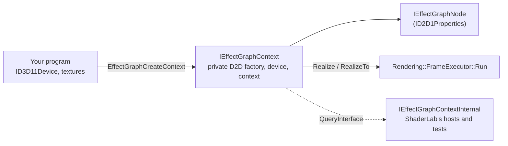

# EffectGraph API

EffectGraph is ShaderLab's engine as a library: the effect catalog, the graph and its evaluator, for any program that already has a D3D11 device. ShaderLab is the editor built on top of it. The public header is [`Engine/Api/EffectGraph.h`](../../Engine/Api/EffectGraph.h); it needs only the Windows SDK (no C++/WinRT, no STL), and the functions are exported from `EffectGraph.dll` ([Linking](#linking)).

```cpp
winrt::com_ptr<IEffectGraphContext> context;
EffectGraphCreateContext(d3dDevice, nullptr, IID_PPV_ARGS(context.put()));

winrt::com_ptr<IEffectGraphNode> input, stats, toneMap;
context->CreateTextureInput(hdrTexture, EFFECTGRAPH_INPUT_ENCODING_SCRGB_LINEAR, input.put());
context->CreateEffect(L"Luminance Statistics", stats.put());
context->CreateEffect(L"ICtCp Tone Map (HDR -> SDR)", toneMap.put());
stats->SetInput(0, input.get());
toneMap->SetInput(0, input.get());
toneMap->Bind(L"SourcePeakNits", stats.get(), L"Max");

context->RealizeTo(toneMap.get(), sdrTexture);   // a B8G8R8A8_UNORM_SRGB target gets sRGB 8-bit
```

## Shape



| Interface | What it is |
|---|---|
| `IEffectGraphContext` | Created from your `ID3D11Device`, which must have `D3D11_CREATE_DEVICE_BGRA_SUPPORT`; it builds a Direct2D factory, device and its own device context on it. Creates nodes (`CreateEffect` by name, `CreateEffectById` by a generated header's class id, `CreateD2DEffect`, inputs), evaluates them (`Realize`, `RealizeTo`), loads saved graphs (`LoadGraph`, `FindNode`), and hands out its D2D device (`GetD2DDevice`) for your own device contexts. |
| `IEffectGraphNode : ID2D1Properties` | A node. Values are read and written as a Direct2D effect's are. Also `SetInput`, `Bind`/`Unbind`, `GetValues`, `GetError`, the name. |
| `IEffectGraphInput` | Only input nodes (`CreateTextureInput`, `CreateImageInput`) answer it: `Invalidate`, `SetTexture`, `SetImage`. |
| `IEffectGraphValues` | A snapshot of a node's analysis fields on the CPU (`GetFloat(L"Max", &peak)`, `GetFloats` for vectors and histograms). |
| `IEffectGraphContext2`, `IEffectGraphNode2`, `IEffectGraphInput2` | 1.1, reached by `QueryInterface` from the 1.0 ones: dirty rects ([Dirty rects](#dirty-rects-11)). An object without one answers `E_NOINTERFACE`. |
| `IEffectGraphValuesBuffer` | A node's analysis fields on the GPU: the D3D11 buffer and view for your own shaders, a CPU read when you want numbers, and writes the rest of the graph sees. |
| `IEffectGraphContextInternal` | Not in the public header ([`EffectGraphInternal.h`](../../Engine/Api/EffectGraphInternal.h)): the graph, evaluator, sources and devices behind a context, for what the public API leaves out on purpose (canvas layout, the UI snapshot, Effect Designer compiles, MCP). Only for programs that link the engine library themselves, on contexts they created; not part of `EffectGraph.dll`'s contract. |

## Linking

NuGet packages carry all of this for other projects: `EffectGraph.Native` for C++ and the C# `EffectGraph` bindings ([EffectGraph Packages](../development/packaging.md)).

Outside programs link `EffectGraph.lib` and ship `EffectGraph.dll` (decision #219). The DLL holds its own copy of the engine and exports only the seven `EffectGraph*` functions; everything else reaches them as COM interfaces. Its build folder, `<Platform>\<Config>\EffectGraph\`, has the DLL, the import library and `include\` with `EffectGraph.h` and every built-in effect header. ShaderLab's own programs (the app, headless, the tests, `EffectGraphCompile`) link the engine library, `EffectGraphEngine.lib`, statically instead and define `EFFECTGRAPH_STATIC`, which makes the API's declarations plain `extern "C"` rather than `dllimport`.

### Versions

EffectGraph is versioned on its own, apart from ShaderLab (decision #229). `EffectGraph.h` includes [`EffectGraphVersion.h`](../../Engine/Api/EffectGraphVersion.h), which defines `EFFECTGRAPH_VERSION_MAJOR`, `_MINOR`, `_PATCH` and `EFFECTGRAPH_VERSION_STRING`; the packages take their version from it. A major version changes the C API, an interface or the effect blob incompatibly; a minor one adds to them. A shipped interface never changes in place: a new one gets a new IID.

Saved graphs carry `formatVersion` (`Graph::cGraphFormatVersion`, raised only when an older engine could not load the JSON safely) and `effectGraphVersion`, the version that saved them. A graph in a newer format is refused with both numbers in the message. Graphs saved before this carry ShaderLab's `appVersion` instead, which the message names.

## Rules

- **The context owns the nodes.** Releasing a node interface does not remove the node; `RemoveNode` does. Each node object holds its context. A node interface whose node was removed, or whose graph `LoadGraph` replaced, returns `EFFECTGRAPH_E_NODE_REMOVED`; one from another context is refused with `EFFECTGRAPH_E_WRONG_CONTEXT`.
- **One thread at a time** per context, like a Direct2D device context. Separate contexts may run on separate threads.
- **Asking for a result evaluates what it needs, and nothing else needs doing** (decision #221). `Realize`, `RealizeTo` and `GetValues` evaluate whatever the node depends on that changed; compute work (statistics, histograms) runs at once, and pixel shaders run when the image `Realize` returns is drawn, as with any D2D effect. The image is valid until the graph next changes; draw it with any device context you create on `GetD2DDevice`, including one that is drawing while the graph evaluates. `RealizeTo` draws the node into your texture and submits it to the device's immediate context, so your next D3D11 work sees the result.
- **There are no draw sessions to manage.** The context evaluates on a device context of its own that callers never see, and opens a session there only for a step that draws (a compute input it cannot read in place, an analysis readback, `RealizeTo`'s draw); a graph of compute on texture inputs opens none.
- **Inputs are read in place.** A linear-scRGB FP16 or FP32 texture is wrapped as a bitmap with no copy, and compute effects bind it directly (decision #209). sRGB 8-bit and HDR10 inputs are decoded to scRGB inside the graph.
- **Properties.** A wrapped Direct2D effect (`CreateD2DEffect`) exposes Direct2D's own property indices, names, types, defaults and sub-properties, answered by an instance of that class. A ShaderLab effect lists its declared parameters first, in order, then any other property. Writes go through `Graph::SetNodeProperty`; integer and boolean values are accepted for a float property. A bound property reads the value its binding resolves to now, which a binding served on the GPU never writes back to the node.
- **Shut down once.** `EffectGraphShutdown` joins the shader compiler's worker threads; call it after releasing every context, before the DLL unloads.

## Implementation

[`Engine/Api/EffectGraphImpl.h`](../../Engine/Api/EffectGraphImpl.h). `Context` and the node objects use C++/WinRT's `implements`, which answers `QueryInterface` only for the interfaces it lists, so each lists every level of its chain (`IEffectGraphContextInternal`, `IEffectGraphContext2` and `IEffectGraphContext`; `IEffectGraphNode2`, `IEffectGraphNode` and `ID2D1Properties`, plus `IEffectGraphInput2` and `IEffectGraphInput` for an input node). A private `INodeIdentity` lets the context find the object behind a node interface it is handed. The context wraps exactly what `HeadlessEngine` owns: a `DeviceStack` built on your device (`Rendering::CreateDeviceStackOn`), a `GraphModel`, a `GraphEvaluator` and a `SourceNodeFactory`; every evaluation is one `FrameExecutor::Run` with the node as its demand root. Input nodes are Source nodes the context never prepares: it points their `cachedOutput` at the wrapped image before each frame.

## Shipping your own effects

An effect authored in ShaderLab's Effect Designer ships inside the program that uses it, compiled, so the program never runs the HLSL compiler (decision #213). Keep the Designer's `.json` in your project and import [`build/EffectGraph.targets`](../../build/EffectGraph.targets):

```xml
<Import Project="path\to\ShaderLab\build\EffectGraph.targets" />
<ItemGroup>
  <EffectGraphEffect Include="Effects\hdr_screenshot_tonemap.json" GpuBound="SourcePeakNits;WhiteErrorBudget" />
</ItemGroup>
```

Before the C++ compile, `EffectGraphCompile.exe` writes `hdr_screenshot_tonemap.effect.h`. Every build is in it; by default every build is compiled in. To keep only what the program uses, define `EFFECTGRAPH_COMPILE_ONLY_REFERENCED` and the selecting macros (the header lists them all) before including it:

```cpp
#define EFFECTGRAPH_COMPILE_ONLY_REFERENCED
#define EFFECTGRAPH_HDR_SCREENSHOT_TONEMAP_8BPC
#define EFFECTGRAPH_HDR_SCREENSHOT_TONEMAP_8BPC_TARGETGAMUT_SRGB
#define EFFECTGRAPH_HDR_SCREENSHOT_TONEMAP_8BPC_QUANTIZE_8_BIT
#define EFFECTGRAPH_HDR_SCREENSHOT_TONEMAP_8BPC_HUEANCHORSOURCE_SRGB
#define EFFECTGRAPH_HDR_SCREENSHOT_TONEMAP_8BPC_GPU_SOURCEPEAKNITS_WHITEERRORBUDGET
#include "hdr_screenshot_tonemap.effect.h"

EffectGraphRegisterEffects(&cHdrScreenshotTonemapEffect);   // at startup
context->CreateEffect(L"HDR Screenshot Tonemap (8bpc)", toneMap.put());
```

With the selection on, a build is compiled in when its effect's macro is defined, its GPU layout's macro is (the all-CPU layout needs none), and for each option it fixes, that value's macro or the option's `_ALL` macro is. An option with none of its macros defined is read at run time, and a selected effect's generic build is always in. Macro names are the effect, option and label names uppercased, each run of other characters one `_`. A misspelt macro selects nothing, silently: the preprocessor cannot report a name it was never told about.

- **What the header and blob hold** ([`Effects/EffectBlob.h`](../../Effects/EffectBlob.h)): the `.json` itself, as the description, and one record per build: its bytecode-cache key in the clear and its DXBC compressed on its own with LZMS (the Windows Compression API, in every Windows since 8). The builds are the generic one, every option combination, and the same again for every combination of the `GpuBound` parameters (bound to an analysis field and served on the GPU). The source is stamped with `IncludeLibraryHash()`, which covers the shared HLSL headers and the cache schema. `--out` writes the same as one `.bin` file, for `EffectGraphRegisterEffect`.
- **Registering** (`EffectGraphRegisterEffects` for a header, which keeps pointers into its arrays; `EffectGraphRegisterEffect` for a `.bin`, which is copied) adds each build to the bytecode cache as a pinned entry (never evicted, cleared or invalidated) holding only its compressed bytes, then registers the effects whose generic build is present, with no compile check. A build is decompressed the first time a node needs it, so memory follows what runs, not what ships. Other shared headers give `EFFECTGRAPH_E_INCOMPATIBLE_EFFECT`; builds that match none of the described effects, or damaged records, are invalid data.
- **A build the program left out is not compiled.** The cache refuses a prebuilt source's missing build unless the request allows it, and the evaluator's fallback takes over: drop the options, then the GPU routing, so a binding with no built layout is served from the CPU readback. Correct, just slower. `EFFECTGRAPH_CONTEXT_FLAGS_ALLOW_RUNTIME_COMPILE` (`EvaluatorOptions::compilePrebuiltEffects`) compiles it instead.
- **`EffectGraphCompile.exe`** parses the `.json` the way registration will, so its keys are the ones `CreateEffect` asks for at run time, and queues every build on a private bytecode cache's workers. The targets file lists the tool and the engine DLL beside it as inputs, so a new engine rebuilds the headers. Measured numbers are in the CHANGELOG entry.
## Effect plugins

A plugin is a DLL that adds effects to whichever EffectGraph loads it, without that program being rebuilt (decision #227). ShaderLab's private effects ship this way. The contract is [`Engine/Api/EffectGraphPlugin.h`](../../Engine/Api/EffectGraphPlugin.h), in the DLL's `include\` folder and the native package:

```cpp
#define EFFECTGRAPH_NO_STARTUP_REGISTRATION
#include "EffectGraphPlugin.h"
#include "MyToneMap.effect.h"          // EffectGraphCompile output, as above

EFFECTGRAPH_PLUGIN_EXPORT HRESULT WINAPI EffectGraphPluginRegister(IEffectGraphPluginHost* host)
{
    return host->RegisterEffects(&cMyToneMapEffect);
}
```

- **A plugin registers through the host, never through the C functions.** Calling `EffectGraphRegisterEffects` would load `EffectGraph.dll` and register into that DLL's engine, not the host's: ShaderLab links the engine statically and exports nothing. So a plugin does not link `EffectGraph.lib`, and turns off the generated header's startup registration. `IEffectGraphPluginHost` has `RegisterEffects` (a generated header, not copied) and `RegisterEffect` (a blob, copied). A later capability, such as CPU-side nodes, will be a new interface a plugin queries the host for, so a plugin built today keeps loading.
- **`EffectGraphLoadPlugin(path)`** loads it with its own folder first on the search path for its dependencies, calls `EffectGraphPluginRegister`, and keeps it loaded for the life of the process, since registered effects point into it. A second load of the same DLL is `S_FALSE`; a DLL without the export is unloaded again and refused with `ERROR_PROC_NOT_FOUND`. Any EffectGraph program can load a plugin: `EffectGraph.dll` exports the function and the C# bindings have `EffectGraphLibrary.LoadPlugin`.
- **Version skew is the blob's problem, not the plugin's.** The effects carry the shader-contract hash, so a plugin built against other shared HLSL headers gets `EFFECTGRAPH_E_INCOMPATIBLE_EFFECT` from `RegisterEffects`, and the host's interface itself does not change.
- **Nothing loads a plugin unless the program asks.** The engine never searches for plugins; a program using EffectGraph runs only the plugins it passes to `EffectGraphLoadPlugin`. That is the library's one guarantee here.
- **ShaderLab treats a plugin like any other effect** ([`Support/EffectPlugins.cpp`](https://github.com/Spruill-1/ShaderLab/blob/main/Support/EffectPlugins.cpp)). It is a development tool and makes no security promise, so a plugin from anyone is loaded the same way as one of ShaderLab's own: every `.dll` in `Effects\` of the app's package and of every package it depends on (or beside the executable, unpackaged), and in the folders it already reads user effects from, the GUI's `%LOCALAPPDATA%\ShaderLab\effects` and headless's `--effects-dir`. Effect `.json` files and plugin DLLs can share a folder. The GUI and headless load them at startup, after `RegisterShaderLabSupport`.
- **Tests:** `TestEffectPlugin.dll` (`Tests/TestPlugin/`) is built the way a real plugin is, an Effect Designer `.json` through `build/EffectGraph.targets` into a header, linking nothing of EffectGraph (12.8 KB). `TestEffectGraphPlugin` loads it into the static engine and `TestEffectGraphPluginInDll` into `EffectGraph.dll`'s; both render its Gain effect exactly with no runtime compile.

## Analysis values on the GPU

`IEffectGraphNode::GetValuesBuffer` hands out a node's analysis fields where the GPU holds them (decision #222), so a program can feed statistics into its own shaders the frame they are computed without waiting for a readback. It evaluates the node first, as `GetValues` does, and reads nothing back.

```cpp
winrt::com_ptr<IEffectGraphValuesBuffer> values;
stats->GetValuesBuffer(values.put());
EFFECTGRAPH_FIELD_INFO max{};
values->GetFieldInfo(values->GetFieldIndex(L"Max"), &max);
winrt::com_ptr<ID3D11ShaderResourceView> view;
values->GetView(view.put());
// HLSL: StructuredBuffer<float4> Stats : register(t0);  float peak = Stats[maxElement].x;
d3dContext->CSSetShaderResources(0, 1, view.addressof());
```

- **Layout.** A `StructuredBuffer<float4>`; fields follow one another in `GetValues`' order, each from `EFFECTGRAPH_FIELD_INFO::bufferElement`. A scalar or vector takes one element (`x`, `xy`, `xyz`, `xyzw`), a `FLOAT_ARRAY` packs four values to an element, any other array takes one element per entry. This is the layout the `SL_FIELD_<name>` macros give a ShaderLab compute shader.
- **What you get.** A D3D11 compute node (Luminance Statistics, Channel Statistics, ...) hands out its own results buffer, so there is no copy. A node whose values are worked out on the CPU (Clock, Numeric Expression, the parameter nodes, the Direct2D Histogram) gets them uploaded into a buffer the context keeps, in the same layout. `GetBuffer` and `GetView` give the raw objects for any D3D11 call.
- **When it is current.** The buffer holds the values of the evaluation that `GetValuesBuffer` ran, until the node is evaluated again, which writes it again: in place for a compute node, on the next `GetValuesBuffer` for any other. D3D11 work you then submit on the device's immediate context runs after the writes. Ask the node again after each evaluation; the buffer can change when the node's fields do.
- **Reading on the CPU.** `ReadValues` copies the buffer to a staging buffer and maps it, which waits for the GPU; call it when you need the numbers, not every frame. `GetValues` does the same for a compute node. A context leaves compute results on the GPU unless something needs them on the CPU: a binding the GPU cannot serve still reads back, and nothing else does.
- **Writing.** `SetFloats` replaces one field until the node is next evaluated, and everything in the graph that reads the field sees the new value: the results buffer is written in place, the copy pixel shaders sample is refreshed, the node's CPU values (which bindings served as constants read) are updated, and the nodes bound to it are evaluated again. The node itself is not, which would write its own values back. Measured: a tone mapper whose `SourcePeakNits` is bound to statistics renders exactly what one with the property set by hand renders, after the statistics' `Max` is written (`TestEffectGraphValuesBuffer`).

## Drawing your own content into a graph

A program that draws with Direct2D (geometry, text, a gradient mesh) gives the result to a graph as an image input. Draw with a device context of your own on the context's D2D device; Direct2D cannot use resources from another D2D device together (its debug layer reports D1121, wrong resource domain). Colours are linear scRGB, as everywhere in the graph: 1.0 is 80 nits, and values above it are HDR.

```cpp
winrt::com_ptr<ID2D1Device> d2dDevice;
context->GetD2DDevice(d2dDevice.put());
winrt::com_ptr<ID2D1DeviceContext> created;
d2dDevice->CreateDeviceContext(D2D1_DEVICE_CONTEXT_OPTIONS_NONE, created.put());
auto dc = created.as<ID2D1DeviceContext2>();      // gradient meshes need ID2D1DeviceContext2

D2D1_GRADIENT_MESH_PATCH patch{};                 // point<column><row>; corner colours
// ... 16 control points over the area, color00/color03 = black, color30/color33 = {4, 4, 4, 1} (320 nits)
winrt::com_ptr<ID2D1GradientMesh> mesh;
dc->CreateGradientMesh(&patch, 1, mesh.put());

// Static content: record it once as a command list.
winrt::com_ptr<ID2D1CommandList> list;
dc->CreateCommandList(list.put());
dc->SetTarget(list.get());
dc->BeginDraw();
dc->DrawGradientMesh(mesh.get());
dc->EndDraw();
list->Close();
dc->SetTarget(nullptr);

winrt::com_ptr<IEffectGraphNode> drawn;
context->CreateImageInput(list.get(), drawn.put());
toneMap->SetInput(0, drawn.get());
```

Two ways to hand it over, and what each costs:

- **A command list** is recorded once and replayed by the graph wherever it is used, so it stores no pixels and has the exact bounds of what was drawn. It cannot change: for new content, record another and give it to the node with `IEffectGraphInput::SetImage`. A compute node cannot read one in place, so each dispatch that needs it draws it into a float copy first.
- **A bitmap you draw into** (`DXGI_FORMAT_R16G16B16A16_FLOAT`, premultiplied, `D2D1_BITMAP_OPTIONS_TARGET`) is read in place by compute nodes. For each new frame draw into it again and call `IEffectGraphInput::Invalidate`. Do not leave it the target of an open draw session while the graph reads it. An 8-bit bitmap would clip everything above 1.0, so keep HDR content in a float format.

Measured (`TestEffectGraphDrawnInput`, hardware adapter and WARP): a black-to-4.0 ramp over 64 x 32 comes through both ways with the expected linear values at every pixel centre (largest error 0.00000), and Luminance Statistics reads the last column's 317.500 nits exactly; redrawing the bitmap at twice the brightness and calling `Invalidate` doubles it.

## Dirty rects (1.1)

A host that keeps its output between frames and knows which rects of its input changed (desktop duplication hands both over with every frame) can redraw only those (decision #238). It tells an input node what changed, realizes into the same texture with `RealizeToIncremental`, and forwards the rects that call reports:

```cpp
auto input2 = input.as<IEffectGraphInput2>();
auto context2 = context.as<IEffectGraphContext2>();

input2->InvalidateRects(dirty, dirtyCount);             // what rewrote the texture this frame
RECT drawn[16];
UINT32 drawnCount = 0;
HRESULT hr = context2->RealizeToIncremental(toneMap.get(), intermediate, EFFECTGRAPH_REALIZE_FLAGS_INCREMENTAL,
                                            drawn, 16, &drawnCount, nullptr, 0, nullptr);
// S_OK: `intermediate` is current, and only `drawn` changed in it.
```

- **What changed travels through the graph.** Rects stay rects through a node that reads input pixel N to write output pixel N: a ShaderLab pixel shader's image pins (they declare `TRIVIAL_SAMPLING`), an Output node, and 17 per-pixel Direct2D built-ins on every pin: Color Matrix, Brightness, Contrast, Exposure, Grayscale, Hue Rotation, Invert, Saturation, Sepia, Temperature & Tint, Posterize, HDR Tone Map, White Level Adjustment, Opacity, Blend, Composite and Alpha Mask (`Graph::RegionIdentityBuiltIns`, each admitted by the D2D oracle test, decision #266). Everything else makes the region the whole output: a blur, every other Direct2D built-in, compute (statistics, histograms, the built-in tone maps: a compute node keeps the rects of its input, which the analysis change gate below uses, but its output is whole), a lookup pin, a pixel shader with a fixed output size (a diagram), and any property, binding or shader change (`Graph::MapRegion`, decision #239). Up to 16 rects are kept per node; more collapse to their bounding box. Moves (below) carry only into an Output node and a pixel shader that declares `shiftInvariant`; up to 16 are kept, more become rects.
- **`RealizeToIncremental`** draws each pending rect clipped, with no clear, and leaves every other pixel of the target as it was. It draws the whole target, reported as one rect covering it, on the node's first realize, without `EFFECTGRAPH_REALIZE_FLAGS_INCREMENTAL`, into a target other than the one it last drew (or one that `RealizeTo` or another node's realize wrote since), after `MoveToDevice`, `ReplaceGraph` or `RemoveNode`, with `dirtyRegions` off, and when the rects cover the target. More rects than `drawnCapacity` are drawn as their bounding box. A realize that fails (a node error, a pending compile) returns the error and leaves its rects pending; the next realize that succeeds draws them (decision #240). A whole draw that fails after clearing the target leaves no record of it, so the next realize into it draws whole (decision #244). With moves (below), a realize may also copy pixels within the target, and reports them in `moved`.
- **`GetInvalidRects`** (on any node) previews what the next realize of that node would draw, changing nothing: what was invalidated since, carried down the graph, plus what is still pending from realizes that did not draw it. Whole for a node no incremental realize has drawn. Forward what `RealizeToIncremental` reports, not this.
- **Moves** (`IEffectGraphInput2::MoveRects`, decisions #260-#264). Hand each frame's move rects to `MoveRects` before its dirty rects to `InvalidateRects`, in desktop duplication's order: the pixels at `SourcePoint` moved to `DestinationRect`, then the dirty rects drawn over. A move's destination is clipped to the input, its source shifted by as much; a move whose source then leaves the input is a dirty rect at its destination (not reported), and one with nothing left is dropped (`S_FALSE`, the call changing nothing). Rects and moves handed in before a `MoveRects` since the last realize count as earlier than its moves (the call starts a new region generation when anything was ingested in the current one), so a host that folds several frames into one realize stays correct: a later frame's move whose source an earlier frame's rect changed is drawn. It travels as a move only into an Output node and into a ShaderLab pixel shader that declares `shiftInvariant` (`CustomEffectDefinition::shiftInvariant`, saved as `"shiftInvariant": true` in the effect's `customEffect`: each output pixel depends only on the same pixel of its one image pin) with exactly one image pin; everywhere else it becomes a dirty rect at its destination, which is always correct. At an incremental realize the root's moves are copied within the target, in order, through a scratch texture the size of the largest destination (two `CopySubresourceRegion` each, after the session's queued drawing is flushed and before the rects are drawn), and `drawn` holds only the rects. A move is drawn at its destination instead when its source overlaps a rect still pending from an earlier frame (the target never got those pixels), when it was pending during that root's last realize, which failed or was compile-pending (a carry-over; judged per root, so realizing another root in between changes nothing), when it reads a destination drawn for either reason, when a second `MoveRects` on the same input came before the realize (the first batch is drawn), when the realize draws whole (a commit, a covering frame), and when `applyMoves` is off (`EvaluatorOptions::applyMoves`, on by default: the kill switch).
  - **`moved`** reports every move handed to an input the root reads since its last successful realize, copied or drawn, in the order they were handed (a root's first realize: those since the last realize of any root). Only moves inside the target are reported: one whose source or destination leaves it is drawn (counted in `movesCollapsed`), and one wholly outside it is neither drawn nor counted. The context holds moves for at most 1024 region generations (`cMaxMoveBacklog`; every realize advances one, and so does a `MoveRects` after anything else was handed in since the last), whatever the host's realize calls: the lists are pruned after every `MoveRects` and every incremental realize, failed or not, so a host that forwards moves but renders with `RealizeTo`, or whose only incremental root keeps failing, holds a bounded list (decision #265). A root not realized successfully for that long, while a move on an input it reads is pending, loses its moves: its next realize draws whole and reports none. Moves on inputs it does not read never cost it a whole draw. Forward them to clients before `drawn`, as duplication does. When they do not fit in `movedCapacity` (or `moved` is null), none is copied, none is reported, and every destination is in `drawn`, so a host that ignores moves stays correct. A `movedCapacity` above 0 with `moved` or `movedCount` null is `E_INVALIDARG`: a move the host cannot count would be copied and never forwarded.
  - **A dithering effect** that declares `shiftInvariant` keeps, in a copied pixel, the dither of the position it was rendered at: up to `cMoveDitherCodes` (3) codes per 8-bit channel off a fresh render, inside moved pixels only, until a rect redraws them. ShaderLab-private's tone map dithers by pixel position and declares it with that caveat. `verifyDirtyRegions` replays the copies it applied on its pre-draw copy of the target, keeps a per-target mask of pixels moved since they were last drawn, and counts differences there within the tolerance as `verifyMoveDrift`, not as whole mismatches.
  - **Which dither the tolerance covers.** The engine cannot see an effect's dither, so `shiftInvariant` is a promise that a copied pixel stays within `cMoveDitherCodes` of a fresh render. `DitherQuantize` (`shaderlab_colormath.hlsli`) has noise support of about ±0.62 × strength codes, so two positions differ by at most 1.24 × strength before rounding: 2 codes at strength 1, 3 at strength 2. ShaderLab-private's tone map caps `DitherStrength` at 2; an effect that dithers harder must not declare the flag. `MoveCase_VerifyDither*` runs `verifyDirtyRegions` over a test-only dithering root at strengths 1 and 2.
  - **Counters** (`RegionDrawStats`): `movesApplied` (copied), `movesCollapsed` (reached the root, were not copied, and `drawn` covers their destination inside the target: measured from what was drawn, so `movesApplied + movesCollapsed` equals the moves handed only when none was dropped), `movesReported`, `movePixelsCopied`. `Stage5_ReplaySynthetic` replays the scenarios with moves against a forced-whole render; `Stage5_MoveCost` times copies against drawing the destinations.
- **Bound analysis values and rects.** A rect upstream of Luminance Statistics need not redraw what its fields feed: the analysis change gate (`EvaluatorOptions::analysisChangeGate`, on by default, decision #247) compares a dispatch's new fields bit for bit with the ones its bound consumers last rendered with, and leaves a consumer clean when no field it reads changed, so its own region stays the rects of its image inputs. It can judge only when the values are on the CPU in the same frame, i.e. with the readback skip off; with the skip on (the context's default) every dispatch over rects dirties its consumers whole, unless the context has deferred commit (below). `Stage2_GateReplaySynthetic` measures how often `Max` and `WhiteErrorBudget` keep their bits on the replay scenarios.
- **`EFFECTGRAPH_CONTEXT_FLAGS_NO_FALLBACK`**: a frame that would run a fallback build (the build the GPU routing of a binding needs is not in the effect's blob and runtime compiles are off, so the binding would be read on the CPU) fails with `EFFECTGRAPH_E_FALLBACK_BUILD`, or `EFFECTGRAPH_E_COMPILE_PENDING` while that build compiles under `ASYNC_COMPILE`; it draws nothing into the target and leaves its rects pending (decision #249). The test is the build each needed node is running, not the frame that chose it: a node left clean on a fallback build refuses every later frame too, including a retry with nothing new, until the exact build is applied. Its analysis dispatches and readbacks have run by then: the flag stops the frame being shown, not the readback. ShaderLab's own hosts and tests read the counts of readbacks by cause and of fallback builds from `GraphEvaluator::ReadbackStats()`, through `IEffectGraphContextInternal`.
- **The device contract**, as for every context: the device was created with `D3D11_CREATE_DEVICE_BGRA_SUPPORT`; creating the context turned on its multithread protection; every input texture and realize target is on the context's device. The context writes only its own targets. A surface on another device (a duplication client's) is the host's to copy into and to synchronise: `RealizeToIncremental` ends with `EndDraw`, which submits to the immediate context, so the host's next D3D11 copy from the target runs after the draw; a client's read on its own device needs the host's own ordering (a keyed mutex in the replay harness).
- **The target**: an `_SRGB` texture gets the sRGB encode on write. A desktop duplication client's surface is `B8G8R8A8_UNORM`, so a stage realizes into its own `_SRGB` texture and copies the drawn rects into the client's with `CopySubresourceRegion` (same typeless group). An `_SRGB` Direct2D bitmap over a `TYPELESS` texture would save the copy, but `CreateBitmapFromDxgiSurface` refuses it with `E_INVALIDARG` (`Stage1_TypelessSrgbTarget`, WARP and the Adreno X2-90).
- **Every draw of a pixel rounds the same way** (decisions #242, #244). The root of an incremental realize is not cached by Direct2D: a cached effect reaches the target through an intermediate and rounds differently from one drawn into it directly (1 code on 6 of 2,048 pixels at half opacity). It stays uncached on every frame after, a `RealizeTo` of it included, so its cache state does not flip between the two. With `dirtyRegions` off it is cached, as in 1.0; the first incremental realize after the switch comes back on draws whole, since the target was drawn the other way. And a ShaderLab pixel shader reads its image pins with a point filter: Direct2D interpolates the texture coordinate with an error that depends on how the draw is split, which a linear filter turned into a blend with the neighbouring texel (up to 8 codes at a sharp edge, on a 256 x 144 target). The filter has its own switch, `EvaluatorOptions::pointImageFilter` (decision #246); off is 1.0's linear filter.
- **Kill switches**: `EvaluatorOptions::dirtyRegions` off makes every realize whole; a host that omits the flag gets the same. `pointImageFilter` off restores 1.0's linear filter on image pins, independently of `dirtyRegions`. `applyMoves` off draws every move at its destination (still reported in `moved`). `verifyDirtyRegions` checks each incremental draw: nothing outside the drawn rects changed against the target as it was with the applied moves replayed, and the target equals a whole render (mismatches go to stderr as `[EffectGraph] verifyDirtyRegions: ...` and into `RegionDrawStats`).
- **Counters**: `GraphEvaluator::RegionStats()`: realizes (every successful `RealizeToIncremental`), draws (those that drew anything), whole draws, rects and pixels drawn, the target's pixels per realize (so an idle realize lowers the drawn share), and what verification found. A test can prove the verifier sees a draw past its clip: `ShaderLab::Api::Testing::g_unclipNextIncrementalDraw` (test code only) makes the next rect draw ignore its clip.

### Deferred analysis commit

A context created with `EFFECTGRAPH_CONTEXT_FLAGS_DEFERRED_ANALYSIS_COMMIT` (EffectGraph 1.1; `EvaluatorOptions::deferredAnalysisCommit`, off by default and only in effect with the readback skip on) never waits for an analysis readback, and decides per bound field when a new value reaches its consumers (decision #250). Without the flag, `TryGetValues`, `CommitFields`, `GetCommittedValues` and `PollReadbacks` return `E_NOT_VALID_STATE`, and policies are ignored (every field behaves as `IMMEDIATE`, as in 1.0).

- **Three value sets per analysis node.** *Committed*: what bound consumers render with (`GetCommittedValues`, and `GetValues`; a GPU-served consumer reads the lane-3 texture, kept texel-equal to the committed record). *Landed*: the newest readback that has arrived (`TryGetValues`, `S_FALSE` until one has). *In flight*: dispatches whose readback is still queued; each dispatch schedules one, and none is waited on.
- **Commit policies**, per binding (`IEffectGraphNode2::SetCommitPolicy(property, policy)` on the consumer, `"commitPolicy"` in JSON, `Graph::SetBindingCommitPolicy` inside the engine): `EXACT` (default) commits a landed value when its bits differ from the committed one; `IMMEDIATE` serves the dispatch's value on the GPU in the same frame, as 1.0 did; `THRESHOLD` commits only when `|landed - committed|` exceeds the field's `changeThreshold` (Luminance Statistics' `WhiteErrorBudget`: 0.05, provisional, decision #251); `HOSTED` never commits on its own after the seed: the host reads `TryGetValues` and writes `CommitFields(names, values, count)` (a field that is bound, `HOSTED`, `float` and finite, else `E_INVALIDARG`), applied at the start of the next frame. Two consumers of one field with different policies fail every consumer of the field, whatever its node kind, with a node error that starts `Commit policy conflict: `; the field commits as `EXACT`, and `CommitFields` refuses it, until they agree, when the consumers render again (decision #255).
- **What a dispatch writes.** A dispatch over the whole input marks every non-`HOSTED` field unknown and copies its results into the texture for them (the masked copy, decision #250); a dispatch over rects copies only `IMMEDIATE` fields, or nothing. A readback older than the newest whole dispatch is discarded; the dispatch's own landing records silently when its value matches; a newer one against an unknown value counts as a change.
- **The seed.** The first readback that lands after the texture's first fill, and is no older than the last whole-input dispatch (one that is older is discarded: the texture holds the newer dispatch's values), seeds every field: committed equals landed, consumers woken. A `HOSTED` field seeded from the fill's own dispatch is recorded silently (its texels already hold the value); a host commit made before the seed survives it, in record and texel, and the field is judged under its policy from then on. A texture first filled after the record was seeded (its consumer read the record as a constant until then) takes each `HOSTED` field's committed value, not the dispatch's (decision #254).
- **Changing a policy** (`SetCommitPolicy`) re-dispatches the producers whole, so their fields are judged under the new policy in that frame.
- **Writing values** (`SetFloats`, `WriteValues`) under the commit writes the results buffer and only the written field's texels, so the texture still equals the committed record; a `HOSTED` field's texel and record move only on `CommitFields`. A write is ordered like a dispatch: a readback in flight from a dispatch no newer than the write, the seed included, leaves the written fields alone when it lands (`hostWritesKept`), so the value holds until the next dispatch, as with the commit off. Before the seed the texels are written too once the texture is filled (decision #255).
- **A readback whose `Map` fails for good** (any failure but `WAS_STILL_DRAWING`) retires its slot and every older one unread. The producer's node error says so, and a whole dispatch is queued whose stamp and readback judge the values again, at the cost of one more whole render (`readbackFailures`; decision #255).
- **A copy pass that could not run** (its masked shader or keep buffer not created) is counted in `copyFailures` and not stamped: when its readback lands, every field is judged against the record and the texels of those that changed are written then.
- **`RealizeToIncremental` returns `S_FALSE`** while readbacks are in flight: the target is current for the committed values. `IEffectGraphContext2::PollReadbacks` lands what has arrived without drawing (`S_FALSE` while some are still pending). A stage polls first, decides its hosted commits, then realizes: `PollReadbacks`, `TryGetValues`, `CommitFields`, `RealizeToIncremental`. Landing distance (frames from dispatch to commit) is 1 on the Adreno X2-90 for the replay scenarios.
- **A new binding on a clean producer** is served from the filled texture; with no texture yet it queues a whole dispatch.
- **Counters**: `GraphEvaluator::DeferredCommit()`: whole and rects dispatches, landed, discarded, seeds, stamps, exact and threshold commits, sub-threshold holds, hosted seeds and commits, landing frames (sum, max), blocking drains, copy failures, host writes kept, readback failures, hosted commit frames (sum, max; from the dispatch whose landed values the host read); `ResetDeferredCommitStats` zeroes them; `ReadbackStats().deferredReadbacks`.
- **Kill switch**: create the context without the flag, or set every binding's policy to `IMMEDIATE`.

`Tests/Rendering/DdaReplayTests.cpp`'s `Stage3_*` tests cover the mechanism and replay the synthetic scenarios with a poll-first stage and a damped hosted driver (`DampedHostedDriver` in `DdaStageSim`; its decay of 30 presents is a harness value, not a recommendation). `Stage3_DdaGraphPolicies` loads ShaderLab-private's `dda_screenshot.json` with `--plugin`.

`Tests/Rendering/DdaReplayTests.cpp` replays desktop frames through the API as a duplication stage would (a simulator in `DdaStageSim.{h,cpp}`: one accumulator per client, the copy into each client's UNORM surface, a retry tick after a failed realize), checking each present against a second context that renders the same frames with `dirtyRegions` and Direct2D output caching off (decision #243). Each present must draw exactly the rects that changed (their bounding box past 16; the whole target for a present with no metadata), and a sentinel written into the target outside them must survive, which is what catches a draw that escapes its clip (decision #245). Recordings from ShaderLab-private's recorder replay with `--recording` ([DDA recordings](../development/dda-recording.md)).

## Built-in effects

ShaderLab's built-in shader effects are not in the engine DLL. Each one is a header that `EffectGraphCompile --builtins` generates from the `BuiltInEffects` library (decision #217): `luminance_statistics.effect.h`, `ictcp_tone_map_hdr_sdr.effect.h` and so on, plus `EffectGraphBuiltIns.h`, which includes all 30. A program has the built-ins whose headers it includes:

```cpp
#include "luminance_statistics.effect.h"   // registers itself when the program starts

winrt::com_ptr<IEffectGraphNode> stats;
context->CreateEffectById(CLSID_EffectGraphLuminanceStatistics, stats.put());
```

- **A header holds the effect's description and every build of it**, compressed, as a Phase 1b blob does: the generic build, each option value and each subset of its GPU-bindable parameters (46 builds for the 30 effects, about 1 MB of headers). Nothing compiles at run time.
- **It registers itself.** An inline variable calls `EffectGraphAddEffects` during static initialization, which only records a pointer, so it is safe under the loader lock of a DLL that includes the header. The engine parses the queued headers the first time its effect list is used. Define `EFFECTGRAPH_NO_STARTUP_REGISTRATION` to register with `EffectGraphRegisterEffects` yourself.
- **Each header defines its effect's class id**, `CLSID_EffectGraph<Name>`: a name-based UUID (version 5) of the effect id, so it survives renames. `CreateEffectById` with it makes a missing include a compile error; `CreateEffect` by name still works.
- **(1.1) Each header names the effect's parameters and analysis fields** for `Bind`, as wide strings beside the class id: `EffectGraph<Name>_Parameters_<Parameter>` and `EffectGraph<Name>_Fields_<Field>` (decision #270). The member keeps its case, and each run of characters outside `[A-Za-z0-9]` becomes one `_`, so Channel Statistics' `Nonzero%` is `EffectGraphChannelStatistics_Fields_Nonzero`. A name with no letters or digits, or one whose constant an earlier name in the same group took, gets a comment saying so instead. A user effect's header from `EffectGraphCompile --header` has the same constants.
- **(1.1) `EffectGraphCoreNodes.h`** gives the eight nodes with no shader the same identifiers: `CLSID_EffectGraphWorkingSpace` with `EffectGraphWorkingSpace_Fields_SdrWhiteNits` and the rest, and likewise for Clock, Numeric Expression, Random and the four parameter nodes. They need no registration, so the header holds only identifiers; `CreateEffectById` creates them, and `EffectGraphBuiltIns.h` includes it.

```cpp
#include "EffectGraphCoreNodes.h"
#include "luminance_statistics.effect.h"
#include "ictcp_tone_map_hdr_sdr.effect.h"

context->CreateEffectById(CLSID_EffectGraphWorkingSpace, workingSpace.put());
context->CreateEffectById(CLSID_EffectGraphLuminanceStatistics, stats.put());
context->CreateEffectById(CLSID_EffectGraphIctcpToneMapHdrSdr, toneMap.put());
stats->Bind(EffectGraphLuminanceStatistics_Parameters_ClipNits, workingSpace.get(),
            EffectGraphWorkingSpace_Fields_SdrWhiteNits);
toneMap->Bind(EffectGraphIctcpToneMapHdrSdr_Parameters_SourcePeakNits, stats.get(),
              EffectGraphLuminanceStatistics_Fields_Max);
```
- **A missing header is named.** The engine keeps every built-in's name and id (`Effects::BuiltInEffectList`), so `CreateEffect` or `CreateEffectById` for a built-in the program did not include returns `EFFECTGRAPH_E_EFFECT_NOT_INCLUDED`, and MCP's `graph_add_node` says which header to include.
- **What stays in the engine:** the eight nodes with no shader (the four parameter nodes, Clock, Numeric Expression, Random, Working Space; Numeric Expression evaluates only where a host registered an expression language, which ShaderLab does and EffectGraph does not, decision #224), the shared HLSL includes, and the C++ three built-ins carry beyond their HLSL (the derived constants of ICtCp Gamut Map and ICtCp Boundary, Side by Side's output size), attached by effect id when they register.
- **Each header is checked against the engine** when it registers: its shader-contract hash must match, as for any blob.

ShaderLab's own programs (the app, headless, the tests) include `EffectGraphBuiltIns.h` through `build/EffectGraphBuiltIns.targets`, which runs the generator before C++ compiles.

## Moving to another device

`IEffectGraphContext::MoveToDevice` puts a context on another `ID3D11Device`: the GUI's adapter switch (decision #215) and recovery from a removed device (decision #220). It builds the new device stack first, a D2D factory and device with the engine's effects registered and a new device context, and fails with nothing changed when that fails, so a refused device leaves the context rendering where it was. Then it releases everything the old device made: the evaluator's effects, compute runners and scratch bitmaps, the sources' bitmaps and decoders, the metadata effects, and every input's wrapped image. The graph stays, with every node dirty, and so do the node interfaces (same objects, same epoch); effects rebuild and sources reopen on the next frame, a capture with the window or monitor it was given. What it cannot carry over is the caller's: images from `Realize`, device contexts made on the old `GetD2DDevice`, and the textures and images given to input nodes, which are empty until `SetTexture` or `SetImage` hands them one on the new device.

### When the device is removed

A removed device (a driver update or reset, a hung or unplugged GPU) is reported, not hidden: once `ID3D11Device::GetDeviceRemovedReason` fails, `Realize`, `RealizeTo` and `Draw` return that reason (`DXGI_ERROR_DEVICE_REMOVED`, `DXGI_ERROR_DEVICE_RESET`, ...) before doing any work, and a frame during which it happens returns it instead of `D2DERR_RECREATE_TARGET` or a node error. The caller recovers the way it handles any removed D3D11 device: create a new one and call `MoveToDevice`, then give input nodes new textures. The graph, the node interfaces and every property value carry over. Internally, `IEffectGraphContextInternal::RunFrame` reports it in `FrameResult::deviceRemoved`.

- **The GUI** checks the device's removed reason on the render worker every iteration and `Present1`'s result on the UI thread. Either one stops the worker's frames, and the next UI tick runs the adapter switch on the same preference (`MainWindow::RecoverDevice`). If no device comes up, nothing renders, the engine's MCP calls answer 503 at once instead of waiting out the dispatch timeout, and the tick tries again every 5 s.
- **Headless** moves its context to a new device on the same `--adapter` choice when a frame reports the device removed, and runs the frame once more (`HeadlessEngine::RecoverDevice`), so a long `--mcp-session` survives a driver reset.
- **Tests** remove a real device without touching the rest of the machine: a D3D11 device made with `D3D11On12CreateDevice` over a WARP D3D12 device is removed by `ID3D12Device5::RemoveDevice` (`TestEffectGraphDeviceRemoved`).

## Replacing the graph

`IEffectGraphContextInternal::ReplaceGraph` swaps the context's whole graph: the GUI's File > Open and MCP's `/graph/clear`, `/graph/load` and `/graph/load-file` use it (decision #216). It releases the old graph's effects and input images, opens the new graph's sources and bumps the context's epoch, so a node interface from before returns `EFFECTGRAPH_E_NODE_REMOVED` even when the new graph reuses its id. Media a host extracted for the new graph stays the host's (`IEngineCommandSink::OnGraphMediaDirChanged`). MCP routes reach the context through `Mcp::EngineContext`, which holds it beside the host's display monitor and hooks.

## ShaderLab's own hosts

Headless (decision #214), the GUI (decision #215) and the MCP routes (decision #216) run on a context, and so does the test runner (decision #218): each test case gets a fresh context on the shared D3D11 device, and the harness's `g_dc`, `g_d2dFactory` and `CaseEvaluator()` are that context's. A test may still build its own `GraphModel` and render it with them, since a graph is plain data; the device, the registered effects and the evaluator are always a context's.
