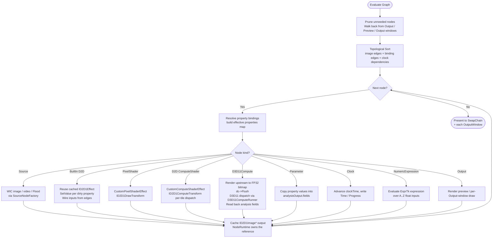

# Topological Evaluation

A cycle, through image edges or property bindings (`TopologicalSort`, `Connect` and `BindProperty` all follow both, through `GraphModel::ForEachDependency`), leaves no order to evaluate in. `Connect` and `BindProperty` refuse one; a loaded file can still carry one. `Evaluate` then sets a cycle `runtimeError` on every node the cycle holds back (`GraphModel::UnorderableNodes`) and returns no image, and clears that error once the graph sorts again.

The evaluator runs at the **monitor's refresh rate** (clamped to 60–240 Hz) on the **render worker thread**. The UI thread starts a `DispatcherQueueTimer` whose interval is set from `EnumDisplaySettings(ENUM_CURRENT_SETTINGS).dmDisplayFrequency`, but its only per-tick job is to drain the dispatcher queue (handling MCP / user commands) and blit the latest published offscreen to the SwapChainPanel-bound swap chain. The actual graph evaluate runs on the worker, dirty-gated (`Evaluate` is skipped entirely unless any node is dirty, an output window is open, the preview wants a fit, or `m_forceRender` was set by user input). The interval is re-applied on every display change (so dragging the window across monitors picks up the new rate). See [Threading Model](https://github.com/Spruill-1/ShaderLab/blob/main/docs/architecture/threading-model.md).

## Where the evaluator lives

`Rendering::GraphEvaluator` is an exported facade holding one pointer to `Rendering::Evaluator::EvaluatorCore`, so changing the evaluator's internals no longer changes the engine's ABI (decisions #168, #169). The core is one class split across files by seam:

| File (`Rendering/Evaluator/`) | Holds |
|---|---|
| `EvaluatorCore.cpp` | `Evaluate`: the pull-dirty walk and one visitor per node kind (`VisitSource`, `VisitBuiltIn`, `VisitParameterNode`, `VisitOutput`; the other two below) |
| `CustomEffectNode.cpp` | custom D2D pixel / compute shaders: baseline auto-compile, `InjectHostDimensions` (OutputW/H, ImageAW..DH), `ApplyCustomEffect` (build choice, reserved pins, cbuffer) |
| `ComputeScheduler.cpp` | D3D11 compute: `QueueD3D11Compute`, `ProcessDeferredCompute` (readback plan, shared pre-render, ordered dispatch), `DispatchViaBridge` |
| `EffectFactory.cpp` | `GetOrCreateEffect`, `ApplyProperties`, `WireInputs`, placeholder bitmaps |
| `AnalysisReadback.cpp` | Histogram and custom-analysis readback, async readback polling, lane-3 texture views |
| `DeferredCommit.cpp` | deferred analysis commit: commit policies per field, copy mode and stamp per dispatch, landing (seed, stamp rule, Exact / Threshold commits), host commits, waking or syncing consumers on a commit (decision #250) |
| `CachePolicy.cpp` | `D2D1_PROPERTY_CACHED` policy, `ReleaseCache`, `InvalidateNode`, `UpdateNodeShader` |
| `VariantSelector.{h,cpp}` | build choice and option precompile (`Select`, `QueueOptionVariants`, `Poll`), `CompileBaseline`, the content-addressed bytecode and reflection memos |
| `BindingResolver.{h,cpp}` | property-binding resolution and the non-finite-safe write-back |
| `ParameterNodes.{h,cpp}` | Clock / Math Expression / Random / constant fields; no device |
| `ComputeDispatch.{h,cpp}` | compute cbuffer packing, output size from properties, per-pixel thread-group counts; no device |
| `NodeRuntime.h`, `InputPins.h` | per-node state; the lane-3 pin layout |

Everything kept per node is one `NodeRuntime` record keyed by node id: the effect instance (effect, output, impl pointers, cache flag), its variant state, its lane-3 texture view and pending async readback -- which `InvalidateNode` and a shader update drop together -- plus what outlives an instance: pre-render targets, the hint-throttle timestamp, a pending fresh-readback request and the output change count. A node removed from the graph loses its record at the next normal pass. State scoped to one pass (`PassState`: output and field changes, effects created) and to one frame's compute queue (`ComputeQueue`) are reset in one place each.

With deferred analysis commit on, a normal pass starts in this order: it opens the frame (the first normal pass after `ProcessDeferredCompute` closed one advances the frame counter that landing distance is measured in), polls the readbacks that have arrived and lands them (seed, stamp rule, `EXACT` / `THRESHOLD` commits), then applies the host's pending `CommitFields`. A commit that changes a field wakes its CPU-served consumers; a GPU-served consumer is already reading the texels the commit wrote, so it gets the value written back to its properties without being dirtied. A new binding on a clean producer is served from its filled lane-3 texture, or queues a whole dispatch when there is none.

## Dirty regions

Since 1.1 a node's dirty state carries *where* it changed (decision #238): `EffectNode::Region()`, a `Graph::DirtyRegion` that is None, up to 16 rects (each tagged with the realize generation it arrived in) or Whole. The flag and the region are private behind `MarkDirty()` (Whole), `MarkDirty(region)` (unions), `ClearDirty()` and `IsDirty()`, so no caller can set one without the other; every older `dirty = true` is `MarkDirty()`, i.e. Whole.

1. **Ingest.** `IEffectGraphInput2::InvalidateRects` (clipped to the texture) and a live source's `ILiveSource::DirtyRects` mark the node with rects. A live source frame with no rect information, or whose rects cover the frame, is Whole; rects that clip to nothing are `NoFrame`.
2. **Propagation.** `GraphModel::PropagateDirtyDownstream(useRegions)` carries each dirty node's region down image edges through `Graph::MapRegion(src, dst, edge, region)`: identity into a ShaderLab pixel shader's image pin (not a lookup pin, not a fixed-size output), into an Output node, into a D3D11 compute node's image pin and into any pin of an allowlisted per-pixel Direct2D built-in (`Graph::RegionIdentityBuiltIns`, moves collapsed; decision #266), Whole everywhere else; a compute node's own output is Whole whatever its input region (`Graph::EmittedRegion`), so the rects it keeps describe what its dispatch read, not what it wrote (decision #248); a node reached by two paths gets the union. `PendingDirtyRegion(id)` runs the same walk read-only, for `GetInvalidRects`. With `dirtyRegions` off every region is promoted to Whole.
3. **Evaluation.** `PassState::outputChanged` maps a node id to the region its output changed by. The pull marks a consumer dirty with `MapRegion` of each changed input's region; a property, binding, shader or bound-source change is Whole. Each pass adds what changed to the node's `NodeRuntime::pendingRegion`, Whole until a host first acknowledges a draw. A D3D11 compute node is queued, not drawn, and the queue clears its dirty state, so the region it was dirtied by is captured into `NodeRuntime::undispatchedRegion` at queue time and moved to `lastDispatchInput` after a successful dispatch. A region left there (a dropped queue, a failed dispatch, a frame the node could not queue for want of an input image) queues the node again on the next frame unless it has a runtime error (decision #257), so a statistics node that recomputes only the dirty cells (`incrementalReductions`) never keeps the partial of a cell whose pixels changed. With `analysisChangeGate` on, an analysis-only compute node is not entered into `outputChanged` at its visit (its change count still moves, `MarkComputeChanged`): its bound consumers are dirtied after the dispatch, by `PublishFieldsIfChanged`, only for fields that changed bit for bit (the gate, [d2d-d3d11-hybrid-compute.md](d2d-d3d11-hybrid-compute.md#known-limitations), decision #247).
4. **Draw.** `FrameRequest::acknowledgeRoots` names the roots the host's draw drew completely; after a successful `EndDraw`, each one with an output, no compile pending and no error has its pending region cleared (`GraphEvaluator::AcknowledgeRegion`). `FrameRequest::uncachedRoots` names nodes Direct2D does not cache that frame (`GraphEvaluator::SetUncachedNodes`): the context puts every root it has realized incrementally there on every frame, so a rect drawn now and the pixels around it drawn earlier went through the same path (decisions #242, #244). `IEffectGraphContext2::RealizeToIncremental` is that host: it reads the root's pending region inside the draw session, after the frame's passes, and draws each rect clipped.
5. **Moves** (1.1, decisions #260-#263). `MoveRects` marks the input with `Graph::DirtyMove`s beside its rects (destination, source point, generation, and a graph-wide sequence that keeps their order and lets a region reached by two paths hold each once). `MapRegion` passes them unchanged into an Output node and into a pixel shader that declares `shiftInvariant` through its one image pin; everywhere else `DirtyRegion::WithMovesCollapsed` turns each into a rect at its destination tagged one generation older than the move, so a later move whose source reads it collapses too. At the draw, `Graph::PlanMoves(region, carryThrough, apply, collapse)` keeps a move, in order, only when it is newer than `carryThrough` (the generation of the root's own last realize, so a move pending through a failed or compile-pending one is a carry-over, and another root's realize changes nothing), `apply` holds (`applyMoves`, and every reported move fits `moved`), its sequence is not listed (a second batch on the same input listed the first), and no pending rect older than it overlaps its source; the rest become rects. Kept moves are copied in the target after `dc->Flush()` and before the clipped rects are drawn; a whole draw copies nothing. A rect of the move's own generation never collapses it: the rects are drawn after the copies. That holds because `MoveRects` advances the generation whenever anything was ingested in the current one (decision #264), so rects of an earlier frame folded into the same realize are older than a later frame's moves.

---

---

Back to [docs/](../README.md) • [Repo root](../../README.md)
